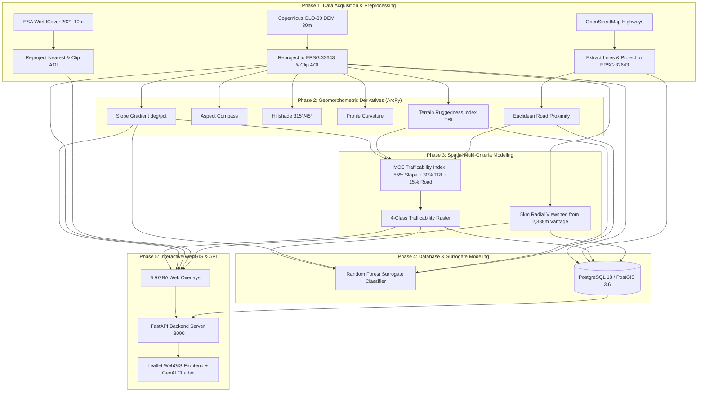

# GeoAI-Based Terrain Trafficability and Visibility Assessment
### A Case Study of Coonoor Taluk, The Nilgiris, Tamil Nadu, India

[](https://www.esri.com/en-us/arcgis/products/arcgis-pro/overview)
[-blue)](https://pro.arcgis.com/en/pro-app/latest/arcpy/main/arcgis-pro-arcpy.htm)
[](https://www.python.org/)
[](https://fastapi.tiangolo.com/)
[](https://leafletjs.com/)
[](https://postgis.net/)
[](./LICENSE)
[-success)](./08_Logs/data_quality_report.txt)

---

## 1. Project Overview & Research Motivation

In montane environments, rugged topography, steep relief gradients, and dense vegetation impose severe constraints on overland vehicle mobility and line-of-sight reconnaissance. Traditional tactical and civil emergency route planning often relies on manual topographic map interpretation, which is slow and subjective.

This repository provides an automated, reproducible **GeoAI geospatial intelligence pipeline** that integrates:
1. Spaceborne high-resolution Digital Elevation Models (**Copernicus GLO-30**),
2. Categorical land cover observations (**ESA WorldCover 2021 10m**),
3. Road transport networks (**OpenStreetMap**),
4. Geomorphometric derivative analysis (**ArcPy Spatial Analyst**),
5. Multi-Criteria Evaluation (**MCE**) for off-road trafficability,
6. Topographic viewshed visibility modeling with analysis buffer zone masking,
7. A **Machine Learning nonlinear surrogate emulator** (Random Forest),
8. An enterprise spatial database (**PostgreSQL 18 / PostGIS 3.6**), and
9. A modern **FastAPI + Leaflet WebGIS interface** equipped with an interactive **GeoAI Assistant chatbot**.

---

## 2. Study Area: Coonoor Taluk, The Nilgiris

- **Location:** The Nilgiris District, Western Ghats, Tamil Nadu, India.
- **Geographic Extent:** $76.6675^\circ\text{ E}$ to $76.8575^\circ\text{ E}$; $11.2368^\circ\text{ N}$ to $11.3846^\circ\text{ N}$.
- **Projected Coordinate System:** **WGS 1984 UTM Zone 43N (EPSG:32643)**.
- **Total Planar Area:** **$222.44\text{ km}^2$** ($22,244.04\text{ ha}$) with an $81.03\text{ km}$ perimeter.
- **Topographic Character:** Dramatic elevation drop across the southeastern Nilgiris escarpment, transitioning from high-altitude montane plateaus down to the Kallar river gorge near Mettupalayam.

---

## 3. Research Objectives & Limitations

### Objectives
- Automate geomorphometric surface processing from raw COG elevation tiles to analysis-ready UTM layers.
- Formulate an objective Multi-Criteria Evaluation (MCE) trafficability index combining slope, terrain ruggedness, and transport proximity.
- Execute line-of-sight visibility analysis from dominant vantage ridges with rigorous localized denominator masking.
- Train an ML surrogate classifier to emulate analytical MCE scoring for accelerated spatial prediction.
- Deliver an interactive, dark-mode WebGIS platform with queryable REST APIs and an AI assistant.

### Operational Disclosures & Academic Scope
> **CRITICAL DISCLOSURE:** This project is an academic geospatial intelligence methodology. It is **not** an operational military navigation system and has not undergone tactical battlefield trials. 
> 
> Off-road vehicle mobility in real operations depends on localized soil mechanics (cone index, moisture saturation), real-time weather, micro-canopy obstacles, and vehicle axle dynamics not captured in a static 30m DEM.

---

## 4. System Architecture



---

## 5. Data Sources & Spatial Specifications

| Dataset | Provider | Native Resolution | Target CRS | License | Processing Method |
| :--- | :--- | :--- | :--- | :--- | :--- |
| **Digital Elevation Model** | Copernicus GLO-30 (ESA/Airbus) | 30 m (1 arc-sec) | EPSG:32643 | Open Access Policy | Bilinear reprojection, clipped |
| **Land Cover (Categorical)**| ESA WorldCover 2021 v200 | 10 m | EPSG:32643 (30m) | CC BY 4.0 | Nearest-neighbor reprojection |
| **Road Network** | OpenStreetMap (Overpass API) | Vector lines | EPSG:32643 | ODbL 1.0 | Polyline parsing, AOI spatial clip |
| **Administrative Boundary** | Survey of India / TNGIS | Vector polygon | EPSG:32643 | Educational / Research | Planar geometric validation |

---

## 6. Analytical Findings & Spatial Statistics

### 6.1 Geomorphometric Surface Parameters
- **Elevation:** Min: **413.07 m**, Max: **2,388.21 m**, Mean: **1,635.93 m MSL**, StdDev: $368.70\text{ m}$.
- **Topographic Slope:** Min: $0.03^\circ$, Max: **$75.78^\circ$**, Mean: **$20.58^\circ$**, StdDev: $10.28^\circ$.
- **Terrain Ruggedness Index (TRI):** Min: $0.24\text{ m}$, Max: $303.73\text{ m}$, Mean: $30.48\text{ m}$ elevation relief per $3\times 3$ window.

### 6.2 Multi-Criteria Trafficability Classification
Off-road vehicle accessibility is modeled using standardized weighted linear combination:

$$\text{Trafficability Score} = 0.55 \cdot S_{\text{norm}} + 0.30 \cdot R_{\text{norm}} + 0.15 \cdot P_{\text{norm}}$$

| Class ID | Designation | Defining Criteria | Area (km²) | Area (ha) | % of Taluk |
| :---: | :--- | :--- | :---: | :---: | :---: |
| **1** | **High Trafficability** | Slopes $\le 10^\circ$, Low Ruggedness | **30.96** | 3,096.18 | **14.06%** |
| **2** | **Moderate Trafficability** | Rolling slopes $10^\circ - 20^\circ$, Moderate TRI | **85.77** | 8,576.55 | **38.94%** |
| **3** | **Restricted Trafficability** | Steep terrain $20^\circ - 30^\circ$, High TRI | **64.44** | 6,444.27 | **29.26%** |
| **4** | **Impassable Barrier** | Slopes $> 30^\circ$, vertical cliffs/gorges | **39.06** | 3,906.45 | **17.74%** |

*Note: $39.06\text{ km}^2$ ($17.74\%$) forms an absolute physical barrier for wheeled tactical vehicles.*

### 6.3 Viewshed Line-of-Sight Visibility
- **Vantage Point:** Northern commanding ridge summit at **2,388.21 m MSL** ($76.7003^\circ\text{ E}$, $11.3671^\circ\text{ N}$).
- **Analysis Radius:** 5.0 km ($5,000\text{ m}$) radial buffer with an eye height of 2.0 m AGL.
- **Localized Analysis Zone (AOI Intersection):** **$40.00\text{ km}^2$**.
- **Visible Area:** **$8.81\text{ km}^2$** (**22.04% of the 5 km analysis zone**; $3.96\%$ of the entire $222.44\text{ km}^2$ taluk).
- **Dead Ground:** $31.18\text{ km}^2$ ($77.96\%$) is topographically shadowed by intervening ridges.

### 6.4 ESA WorldCover Land Cover Classes
- **Tree Cover:** **149.72 km² (67.31%)** — Dominant montane shola and moist deciduous forests.
- **Grassland:** **58.87 km² (26.47%)** — High-altitude plateau grasslands.
- **Built-up Settlements:** **7.95 km² (3.57%)** — Coonoor urban core, Aravankadu, Wellington cantonment.
- **Commercial Cropland:** **5.77 km² (2.59%)** — Tea plantations and terraced vegetable agriculture.
- **Bare Soil / Water Bodies:** $<0.1\text{ km}^2$ ($<0.06\%$).

---

## 7. Machine Learning Surrogate Modeling

### Model Formulation & Honest Disclosure
> **METHODOLOGICAL CLARITY:** The Machine Learning model in this repository is a **computational surrogate emulator**, not a physical ground-truth predictor.
> 
> Because ground-truth historical vehicle traverse telemetry does not exist for every 30m grid cell in Coonoor, the Random Forest model was trained on **244,705 rule-derived pseudo-labels** produced by the Multi-Criteria Evaluation engine.
> 
> The **100.00% validation accuracy** reflects **algorithmic fidelity** (the ability of the Random Forest to approximate the nonlinear MCE decision surface), not empirical real-world ground-truth accuracy.

### Model Architecture & Feature Importance
- **Algorithm:** Random Forest Classifier (`n_estimators=100`, `max_depth=12`, 70/30 stratified train/test split).
- **Sample Count:** 244,705 grid cells (73,412 held-out test cells).
- **Feature Importance Breakdown:**
  1. Topographic Slope (`slope_deg`): **61.73%**
  2. Terrain Ruggedness Index (`tri_ruggedness`): **33.38%**
  3. Elevation MSL (`elevation_m`): **2.80%**
  4. Road Proximity (`road_proximity_m`): **1.59%**
  5. Aspect (`aspect_deg`): **0.28%**
  6. Surface Curvature (`curvature`): **0.21%**

Artifacts are preserved in `11_ML/random_forest_surrogate.joblib` and `11_ML/feature_importance.csv`.

---

## 8. Enterprise Spatial Database Architecture (PostGIS)

All processed spatial layers are managed in **PostgreSQL 18.3 / PostGIS 3.6.1** under the dedicated schema `coonoor_geoai`:

```sql
-- Core Schema DDL snippet from 10_PostGIS/schema.sql
CREATE SCHEMA IF NOT EXISTS coonoor_geoai;

CREATE TABLE coonoor_geoai.aoi_boundary (
    id SERIAL PRIMARY KEY,
    name VARCHAR(100),
    area_sqkm NUMERIC(10,4),
    geom geometry(MultiPolygon, 32643)
);
CREATE INDEX idx_aoi_geom ON coonoor_geoai.aoi_boundary USING GIST(geom);

CREATE TABLE coonoor_geoai.roads_network (
    id SERIAL PRIMARY KEY,
    osm_id VARCHAR(50),
    highway VARCHAR(50),
    name VARCHAR(100),
    geom geometry(MultiLineString, 32643)
);
CREATE INDEX idx_roads_geom ON coonoor_geoai.roads_network USING GIST(geom);
```

### Verified Active Tables & GiST Spatial Indexes
- `aoi_boundary`: 1 record (`ST_MultiPolygon`, EPSG:32643), GiST index `idx_aoi_geom`.
- `roads_network`: 993 records (`ST_MultiLineString`, EPSG:32643), GiST index `idx_roads_geom`.
- `observer_points`: 1 record (`ST_Point`, EPSG:32643), GiST index `idx_observer_geom`.
- `viewshed_zones`: 1 record (`ST_MultiPolygon`, EPSG:32643), GiST index `idx_viewshed_zone_geom`.
- `trafficability_classes`: 4 discrete MCE classification records.
- `landcover_classes`: 6 ESA WorldCover categorical records.
- `terrain_statistics`: 7 geomorphometric parameter records.

---

## 9. FastAPI REST Endpoints

The backend is built with FastAPI, providing CORS-enabled JSON endpoints and streaming GeoJSON layers:

| Endpoint | Method | Response Description |
| :--- | :---: | :--- |
| `/api/health` | GET | System status, study area, and data source manifest |
| `/api/metadata/overlays` | GET | WGS84 bounding coordinates `[[S, W], [N, E]]` and layer properties |
| `/api/stats/terrain` | GET | Elevation, slope, aspect, hillshade, curvature, and TRI statistics |
| `/api/stats/trafficability`| GET | Area and percentage breakdown across 4 movement zones |
| `/api/stats/visibility` | GET | 5 km viewshed metrics, observer coordinates, and zone percentages |
| `/api/stats/landcover` | GET | ESA WorldCover 2021 area, percentage, and hex colors |
| `/api/stats/roads` | GET | OSM road lengths by classification and network density |
| `/api/geojson/aoi` | GET | Coonoor Taluk vector boundary as EPSG:4326 GeoJSON |
| `/api/geojson/roads` | GET | 993-segment OSM road network as EPSG:4326 GeoJSON |
| `/api/geojson/observer` | GET | 2,388m vantage ridge observer location as GeoJSON |
| `/api/postgis/status` | GET | Live PostgreSQL connection health check & table row counts |
| `/api/chat` | POST | Deterministic rule-based GeoAI intelligence queries |

### Example Query (`/api/chat`):
```bash
curl -X POST "http://localhost:8000/api/chat" \
     -H "Content-Type: application/json" \
     -d '{"query": "What is the trafficability breakdown?"}'
```

---

## 10. Interactive WebGIS Frontend

Accessible at `http://localhost:8000` or by opening `06_Outputs/Web_App/index.html`:

- **Layer Switcher:** Seamlessly toggle between:
  1. Digital Elevation Model (`elevation_overlay.png`),
  2. Analytical Hillshade (`hillshade_overlay.png`),
  3. Topographic Slope Gradient (`slope_overlay.png`),
  4. 4-Class Terrain Trafficability (`trafficability_overlay.png`),
  5. Topographic Viewshed (`viewshed_overlay.png`),
  6. ESA WorldCover Land Cover (`landcover_overlay.png`).
- **Continuous Opacity Slider:** Real-time opacity blending (0% to 100%).
- **Vector Overlays:** Toggleable boundary, roads, and observer 5 km circle.
- **Basemaps:** CartoDB Dark, Esri World Imagery Satellite, OpenTopoMap, OpenStreetMap.
- **Statistical Charts:** Responsive horizontal distribution charts for trafficability, land cover, and road hierarchy.
- **Coordinate Readout:** Live cursor coordinates in WGS84 Lat/Lon.

---

## 11. GeoAI Assistant Chatbot

The WebGIS features a built-in **GeoAI Assistant** accessible via the robot icon floating action button:

### Capabilities & Supported Questions
- **Elevation:** "What is the elevation range?", "What is the highest point?"
- **Trafficability:** "What is the trafficability breakdown?", "How much area is impassable?"
- **Viewshed:** "What is the viewshed visibility?", "How far can the observer see?"
- **Slope:** "What is the mean slope?", "Where are the steep cliffs?"
- **Land Cover:** "What are the land cover classes?", "How much forest cover is there?"
- **Roads:** "Tell me about the road network", "What is the road density?"
- **Machine Learning:** "What is the ML feature importance?", "How was the model trained?"

### Architectural Transparency
- **Engine Type:** **Deterministic rule-based and spatial-database-backed query engine** (Non-LLM).
- **Data Source:** Pulls verified real numbers from the project's analytical tables and PostGIS database.
- **Interactive Map Hook:** Whenever the assistant mentions an analytical layer (e.g., Trafficability or Viewshed), it displays an action button to **activate that layer on the map automatically**.

---

## 12. Quick Start & Execution Guide (Windows)

### Prerequisites
- Windows 10/11 x64
- Python 3.11 with packages in `requirements.txt`
- ArcGIS Pro 3.5 with Spatial Analyst extension (for rerunning raw raster geoprocessing)
- PostgreSQL 18 with PostGIS 3.6 (optional for live database queries)

### 1. Launch WebGIS Application Immediately
Run the one-click startup script:
```powershell
& "D:\Defence\MyProject1\start_app.bat"
```
Or start via Python:
```powershell
python start_backend.py
```
Then visit:
- **WebGIS Interface:** [http://localhost:8000](http://localhost:8000)
- **Interactive OpenAPI Documentation:** [http://localhost:8000/docs](http://localhost:8000/docs)

*Note: You can also open `06_Outputs/Web_App/index.html` directly in Chrome/Edge without starting any server.*

### 2. Configure Database (Optional)
Copy `.env.example` to `.env` in `09_Config/`:
```ini
PGHOST=localhost
PGPORT=5432
PGDATABASE=postgres
PGUSER=postgres
PGPASSWORD=your_password
PGSCHEMA=coonoor_geoai
```
Load the spatial database:
```powershell
& "D:\ArcGIS\Pro\bin\Python\envs\arcgispro-py3\python.exe" "05_Scripts\08_load_postgis.py"
```

### 3. Re-run Entire Automated Pipeline from Scratch
```powershell
& "D:\ArcGIS\Pro\bin\Python\envs\arcgispro-py3\python.exe" "05_Scripts\run_pipeline.py"
```

---

## 13. Quality Audit & Verified Outputs

The project underwent a rigorous 50-point automated quality assurance audit executed by `05_Scripts/07_validate_outputs.py`:
- **50 / 50 deliverables present, non-empty, and verified (100.0% compliance score)**.
- Full manifest logged in `07_Metadata/data_manifest.csv`.
- Full audit report logged in `08_Logs/data_quality_report.txt`.

### Cartographic Publications (`06_Outputs/Maps/`)
1. **Map 01:** Elevation & Analytical Hillshade (300 DPI PNG & vector PDF)
2. **Map 02:** Topographic Slope Gradient (300 DPI PNG & vector PDF)
3. **Map 03:** Multi-Criteria Trafficability Classification (300 DPI PNG & vector PDF)
4. **Map 04:** Topographic Viewshed & Line-of-Sight (300 DPI PNG & vector PDF)

---

## 14. Credits, Data Citations & Licensing

### Data Citations
- **Copernicus DEM GLO-30:** European Space Agency & Airbus Defence and Space (2024). Provided via AWS Open Data Sponsorship Program.
- **ESA WorldCover 10m 2021 v200:** Zanaga, D. et al., European Space Agency / VITO Remote Sensing (2022). [https://doi.org/10.5281/zenodo.5571936](https://doi.org/10.5281/zenodo.5571936).
- **OpenStreetMap Data:** (c) OpenStreetMap contributors (2026). Open Database License (ODbL) 1.0.

### Code License
All pipeline source code, backend APIs, and WebGIS frontend scripts are released under the [MIT License](./LICENSE).
